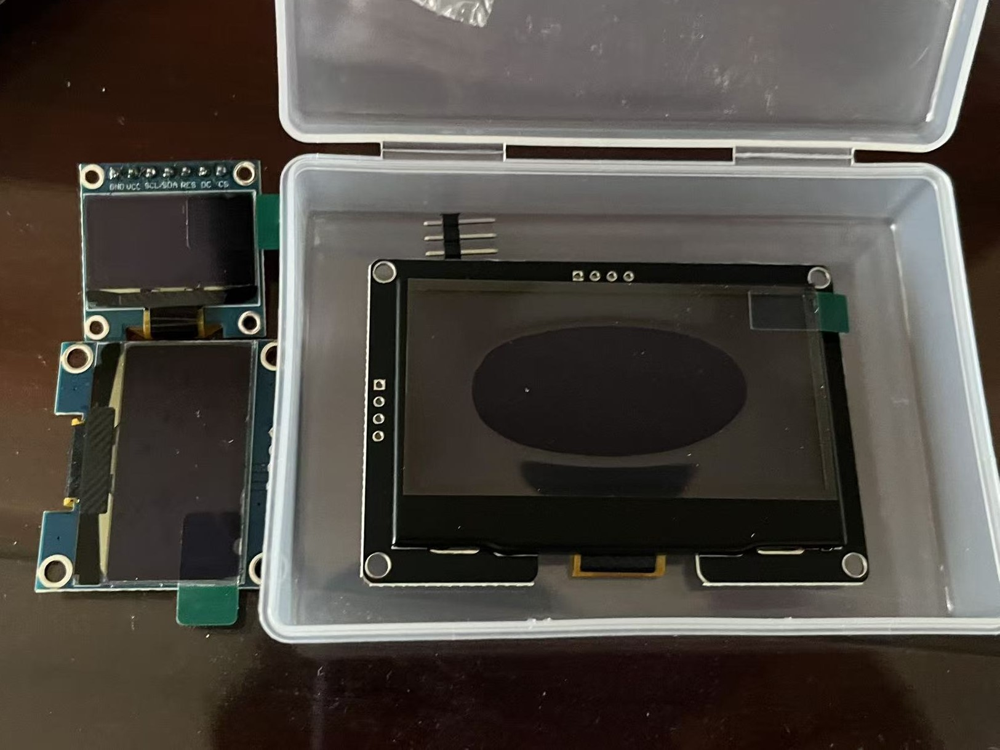
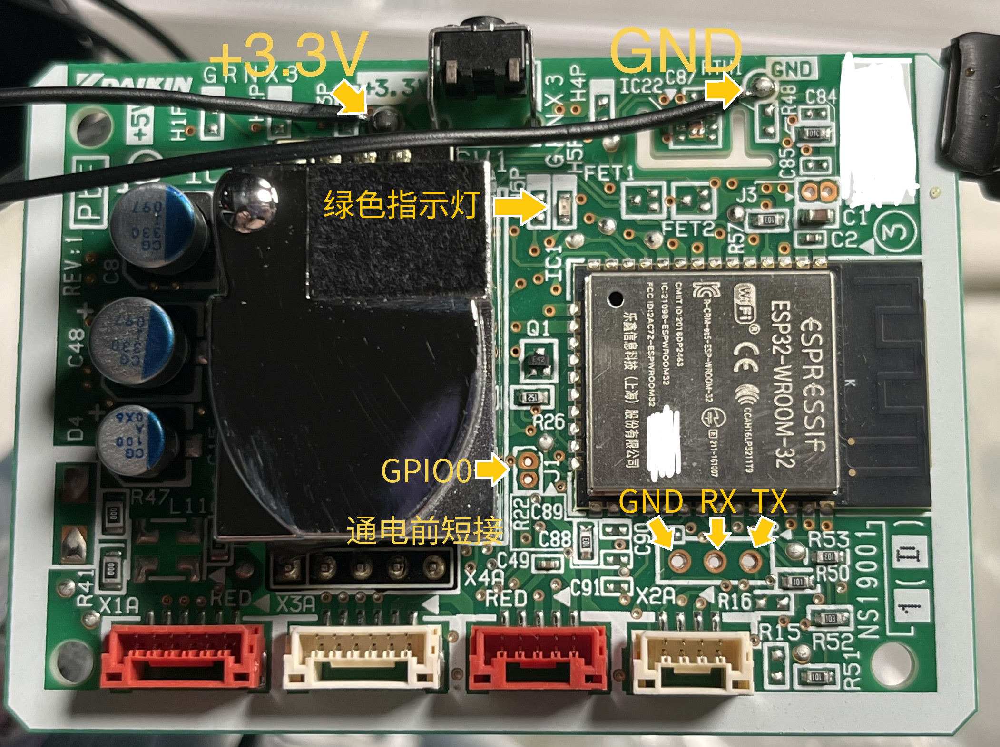
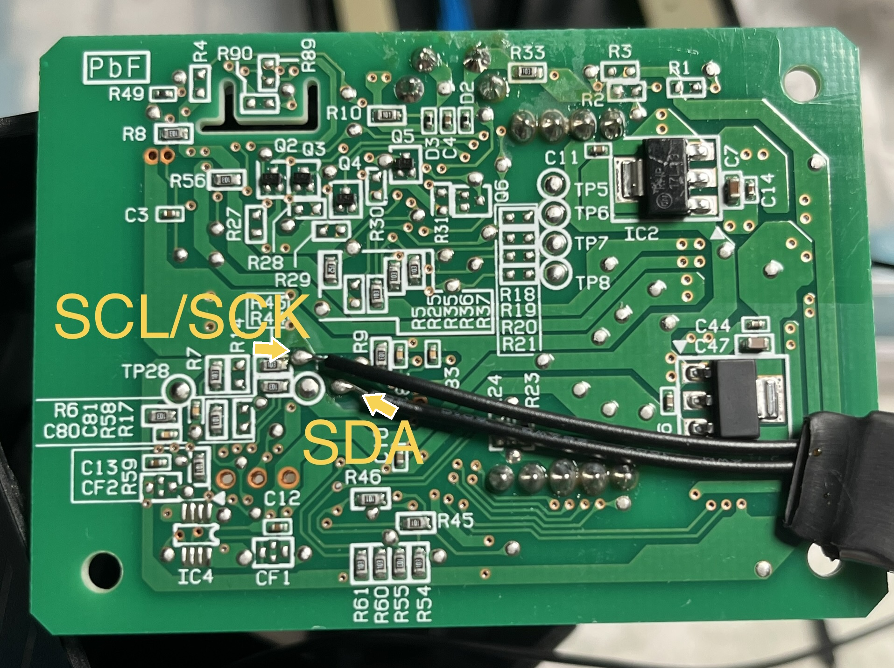

# DaikinOLED 
## Modified Daikin BRY88AB151K Air Sensor. 
#### This device is probably sold only in China and may be difficult to purchase in other markets. 
A modified device designed to detect and display weather, temperature, humidity, PM2.5, CO2, and TVOC levels. 
It is compatible with Homeassistant. Compatible with 0.96-inch, 1.3-inch, and 2.42-inch OLED displays. 
Video tutorials and 3D case will be added here in future updates. 
## 魔改大金BRY88AB151K空气传感器 
单机实现天气, 温湿度, PM2.5, CO2, TVOC检测与显示，亦可接入Homeassistant得到更多功能 
适配0.96/1.3/2.42英寸OLED显示屏，视频教程及3D打印外壳（优化中）待后续此处更新 

#### 灵感来自louliangsheng大佬的[项目](https://github.com/louliangsheng/daikin-air-sensor.)  
原版项目已经不能在新版Esphome下编译，遂重写了整个项目，已经更新了16个版本了(x) 
### 制作教程 
#### 准备材料：
1. Daikin BRY88AB151K主机1个（暂不支持BRY88AA151K，AA主机里的传感器型号不同）
2. 0.96/1.3/2.42英寸OLED屏幕1片（推荐1.3以上，和0.96价格差不多但是屏幕大不少，2.42亦可如果不在意价格）
3. 弯针2.54mm排针4个（买铜镀锡或镀金，避免买到铁脚）
4. 单母头尾部沾锡杜邦线4条（推荐买铜杜邦线头，线径26AWG外径1.3mm，长度20~30mm）
5. 烙铁及焊锡丝
6. USB转TTL刷机模块
7. 公转母杜邦线3根（TTL刷机使用）
8. 3D打印外壳1个（推荐黑灰白三色打印，建议使用冷打板可以获得更好的表面效果） 

以下是屏幕尺寸对比：

#### 拆机步骤：
1. 使用两片0.1mm厚度三角形撬片，一片由CO2至TVOC之间的边框缝隙插入，另一片由CO2至WiFi图标直接的缝隙插入，并且向外撬动，撬开上盖
2. 小心的剪开轧带（请勿伤到内部数据线）
3. 按住4个插头并向后拔下，取出主板，H2OC的USB接口和指示灯面板上盖可先放置一旁 

#### 焊接步骤：
1. 使用4Pin 2.54mm弯针焊接在OLED通孔上
2. 拆开主机上盖取出主板，从主机外壳左下方，找4个孔位塞入4根单头杜邦线（沾锡头侧）
3. 按图分别在主板上下层焊接+3.3v, GND, SCL(SCK), SDA测试点（注意理线，主板塞入时，线不打结为佳）
4. 为上述焊接好的线在机身外的杜邦线头上做好记号！尤其注意+3.3v和GND不能接反！ 

注：刷机后暂不组装，还需要直连主板刷机 

#### 刷机步骤：
1. 插上最左侧由外部引入的进线插头用于设备供电（仅插设备侧，USB侧请先不要通电）
2. 将USB转TTL刷机模块分别对应连接GND<->GND, TX<->RX, RX<->TX
3. 使用镊子短接GPIO0与GND针脚的同时，将设备的USB头接入电源，并观察CO2模块附近的绿色LED，未闪烁则进入刷机模式
4. 电脑上使用任意esp刷机工具（如esptool，ESP32 Web Flasher等）此处使用[nodemcu-pyflasher](https://github.com/marcelstoer/nodemcu-pyflasher/releases)进行演示
5. Serial port中选择你的USB转TTL设备的COM口（可在设备管理器中寻找你的设备型号（如CH340x，CP210x等）对应的COM号）
6. 按屏幕（0.96，2.42英寸常用SSD1306驱动芯片，1.3英寸常用SH1106驱动芯片）与你设备中PM传感器型号（银色选2005，黑色选2105）选择固件（TTL刷机务必选择.factory固件）
7. Baud rate: 115200, Flash mode: Dual I/O(DIO), Erase flash: yes, wipes all data. 确认无误后点击Flash NodeMCU等待完成刷机即可
8. 出现Firmware flash successful则代表刷机成功，断开电源与TTL线即可
9. 将设备内部4个插头连接好，扣回上盖，将屏幕安装至3D打印外壳，并整理4根导线从CO2下方开孔处穿出，扣上3D打印外壳，压紧导线完成组装 

注：如果遇到短接始终通电后闪绿色灯，可能是由于PCB涂有绝缘防水胶导致，请尝试上下移动镊子让镊子穿破防水层短接上触点 

#### 使用步骤：
1. 通电后1-2分钟，设备将提供一个配网用AP：DAIKIN Fallback Hotspot。连接后在弹出网页上选择你自己的WiFi并连接（如未弹出配网页面，请尝试在连接AP情况下打开浏览器中输入 http://192.168.4.1/wifi 进行配网）
2. 成功连接WiFi后会在设备OLED屏幕上跳出设备的IP地址，请记录并在浏览器上打开（如来不及看到WiFi信息页请拔下USB再插回即显示）
3. 请查询你所在位置的经纬度以提供天气查询使用，在Weather Latitude中输入经度，在Weather Longitude中输入纬度，并可根据需求可设置Weather Refresh Interval刷新时间间隔，如不需要天气请参考第7点，将Weather项改为Skip后，便不会执行天气获取
4. 请确保房间充分通风后（保持窗户大门打开，人员离开房间10分钟以上），点击CO2 Calibration进行二氧化碳传感器校准（校准为基准线400ppm）
##### 可选步骤：
5. 可根据你的需要开关：Alert LEDs（设备上的CO2, TVOC, PM2.5蓝色警告灯），以及设置对应告警阈值：CO2 Alert Limit, TVOC Alert Limit, PM2.5 Alert Limit
6. 可根据你的需要开关屏幕：OLED Screen，调整屏幕亮度：OLED Brightness，及设置屏幕自动开关时间：Screen Schedule（开启后请指定对应On, Off的具体时间）
7. 可根据需要设置第x屏显示内容：Page x Content，第x屏显示时间：Page x Duration，及屏幕切换时的特效：Screen Transition Effect 

#### FAQ：
1. 设备一直无法进入刷机模式：请确保你的镊子是可导电的金属，试着孔中上下移动磨穿防水胶。亦或者你可以使用导线，回形针短接
2. USB转TTL刷机一直出现错误：可以尝试将H2.54直针焊接到3个通孔上，再使用杜邦线连接以获得稳定的通信
3. 屏幕安装后不显示，WiFi灯快闪：请尝试对调屏幕两根数据线（SCL(SCK)<->SDA），或请编辑源码尝试使用0x3D来初始化屏幕
4. 屏幕出现显示异常，左侧或右侧出现亮线或屏幕闪烁：请尝试刷另一个屏幕芯片的固件，可能你的屏幕芯片并非当前所选固件的型号
5. 二氧化碳告警灯一直常亮（或数值一直很高）：请参考使用步骤第4点操作，完全通风的房间下二氧化碳本底浓度应为400-420ppm左右
6. 是否会支持甲醛模块：理论上已经实现，但相关库作者没有提供开源协议，后续可能尝试以提供部分调用相关库的代码形式发布
7. 是否会支持BRY88AA151K型号的传感器：AA款使用了不同传感器，大部分也是库开源协议问题，后续可能会跟进 

#### 感谢列表，献给伟大的开源项目：
Esphome项目：[Esphome](https://github.com/esphome/esphome.) 
louliangsheng大佬的：[daikin-air-sensor](https://github.com/louliangsheng/daikin-air-sensor.) 
好看的开源字体：
[Finlandica Headline](https://fonts.google.com/specimen/Finlandica+Headline.)
[Roboto](https://fonts.google.com/specimen/Roboto) 
好看的图标字体：
[MaterialDesign-Webfont](https://github.com/Templarian/MaterialDesign-Webfont)
[meteocons](https://demo.alessioatzeni.com/meteocons/)

#### 一些废话：
1. 作者做了十多只测试用少量成品，上架咸鱼后放连接，售罄应该不补了（卖的贵，严肃推荐你自制，难度仅2/5星）
2. 温度偏移量(Temperature Offset = +4.5)与湿度增益值(Humidity Gain = 1.13)已经过多台温湿度计确认和匹配，如果有更精确的校准数值请提交issue
3. 设备的CO2测量值，在完成校准之后精度和响应速度还是非常不错的，测试与青萍CO2检测仪使用的Sensirion SCD4x相差无几
4. 如果各位大佬有可以精准测量总挥发性有机化合物的增益值(TVOC Gain)的请提交issue，目前设备数值未必可靠 

#### 本项目以GPLv3发布，总体制作难度不大，欢迎自制，任何问题请提交issue，商用请联系作者 
